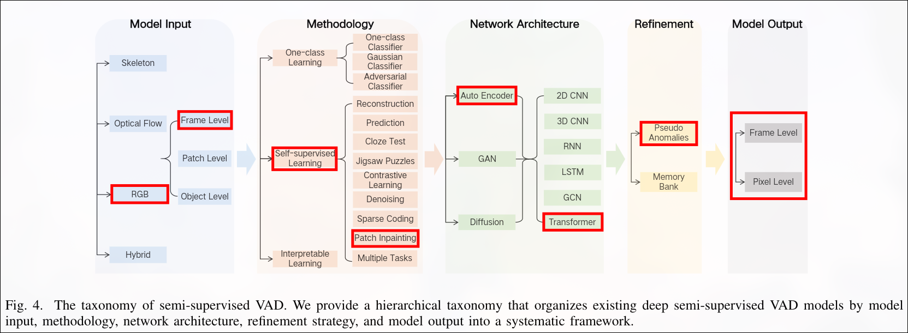
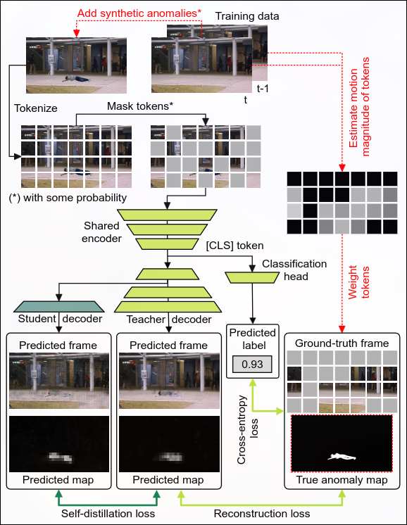
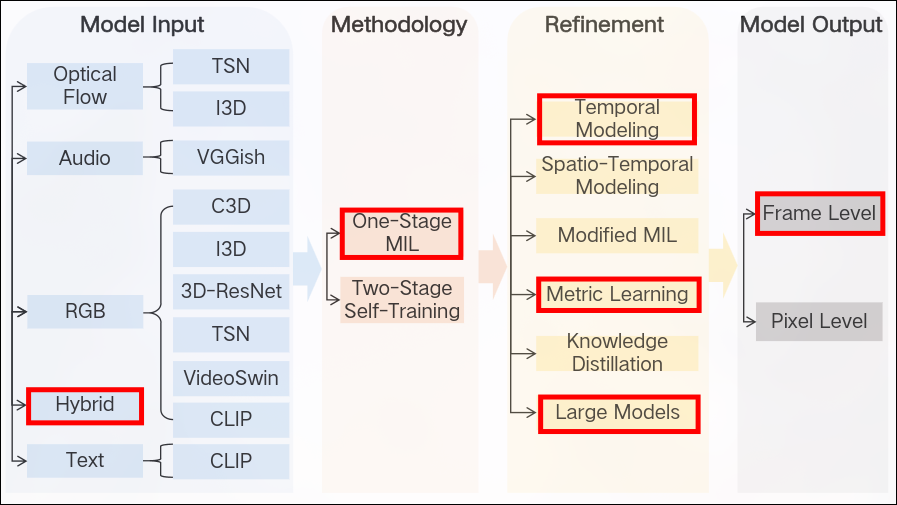
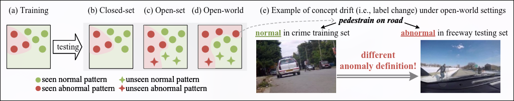
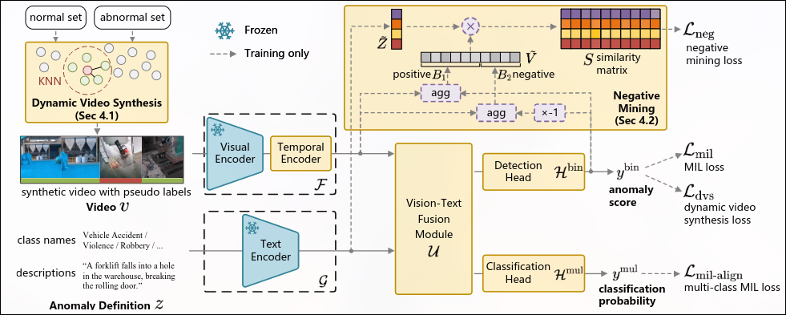

# 2026.10.14 組內階段性紀錄
> 作者：Bongo | Date: 2026.10.18 (Sun)

## 摘要

專題的收斂一直都沒有統一的共識、方向、決策，導致大家都不知道：
- 題目是什麼？
- 架構是什麼？
- 目前遇到的問題？
- 我們應該做什麼？
- ...

導致組員之間的合作與各自對專題的理解有一些偏見，甚至於不知道要做什麼？

本篇統整專題目前的定位與動機、系統提案、三個候選模型的分析、兩個候選場景，以及尚未解決的問題，方便組員共同討論出解決方案。

**目前的提案**：以「異常檢測」與「即時性」為定位，用 AED-MAE 作為第一階段篩選模型，找出異常片段與位置，再交給下游 LaGoVAD 或 AnomalyRuler 做二次判斷與分類。

**需要決定的事**：
1. 下游模型選 LaGoVAD 還是 AnomalyRuler？
2. 場景選「校園道路異常行為偵測」還是「校園場景」？

兩者都需要先做技術驗證才能決定，詳見「問題彙整」。

## 前言/介紹

### 階段性報告的意義

本文件的「報告」表示經過討論被確定的事項，「紀錄」表示尚未決定的事項，兩者有根本性的不同。本篇屬於「紀錄」而非報告，實際結果以下一週報告為主。

本階段性紀錄並不等於 User Need 那樣明確，但是可以作為 User Need 文件的參考。
用意在於統整目前這一個禮拜發生了什麼事、現階段的狀況、確定或者不確定的事情，方便所有人了解狀況。

並不包含和助教的會議紀錄，兩者性質不同。

## 背景

> 備註：並非該領域的研究背景。

### 名詞解釋

- 延遲時間：從輸入到獲得完整結果系統所需要的時間
- 運行成本：跑起這一套系統所需的最低硬體設備（主要討論 GPU）
- 資料成本：獲取資料的容易度，在異常檢測領域普遍難度叫高（因為異常並不常發生）

### 專題定位/動機

本專題的定位在於「異常檢測」與「即時性」，淺在的應用如：
- A. 非即時性的檢測異常
- B. 即時性的檢測異常
- C. 精細的異常檢測、分類

A 與 B 主要的差異在於可接受的延遲時間：
- A 可以接受的延遲時間幾乎沒有限制，唯一在意的是用戶體驗，因此延遲時間依照具體應用場景而定
- B 可以接受的延遲時間最好低於一分鐘，實際情況依照使用場景而定

考慮 A 淺在的應用場景：
- 監視器影片回放

透過監視器影片回放的方式找到異常，但通常這種狀況會被需要表示可能已經發生了某些損失。
站在使用者的立場應該會希望異常能夠即時的被捕獲並且得到解決，因此這類型的使用場景還需要被討論。

考慮 B 淺在的應用場景：
- 監視器的即時監控

監視器的即時監控有助於異常即時的被發現，例如商場、學校走廊監視器在發現鬥毆情形發聲，立刻通知警衛隊。
站在使用者的立場會希望越早發現越好。

C 考慮的是異常分類的顆粒度，對於某些場景可能會需要紀錄當日發生的異常數量、異常種類，並且紀錄以便後續的追蹤。

## 系統概述

AED-MAE 提出的 Auto-Encoder 作為第一階段的篩選模型，篩選出有問題的片段並交給下游 LaGoVAD 或者 AnomalyRuler。
下游模型的定位是比 AED-MAE 還要值得信賴的模型，除了提供更加精細的異常分類外，其模型本身還要比上游模型還要值得信任。

換言之上游模型作為過濾器的角色，提供初步的異常判斷，在追求速度的同時不能丟失太多的精細度。
下游模型作為二次判斷的角色，除了校正上游模型的判斷之外，對於異常片段提供更加詳細的異常分類。

| | 上游：AED-MAE | 下游：LaGoVAD | 下游：AnomalyRuler |
|---|---|---|---|
| 角色 | 過濾器，初步判斷 | 二次判斷 | 二次判斷 |
| 任務 | 找出異常片段、標注異常位置 | 為異常分類 | 為異常分類、提供可解釋性 |
| 輸出 | frame-level 異常分數、pixel-level anomaly map | frame-level 異常分數、各類別機率 | frame-level 異常分數、依 rules 的判斷理由 |
| 異常的定義 | 偏離該場景的正常（隱含在權重中） | 使用者以文字給定，可隨時更換 | 由 normal 範例歸納成文字 rules，可閱讀與修改 |
| 是否需訓練 | 需要，且要合成異常資料 | 論文提供預訓練模型，未針對我們場景驗證 | 不訓練，few-normal-shot prompting |
| 速度 | 論文宣稱 1655 FPS | 論文未報告 FPS；自述比 LLM 方法快（評估時間為分鐘對小時） | 每個 frame 需跑 VLM 與 LLM，論文未報告 FPS |
| 運行成本 | 低：約 3M 參數 | 論文稱實驗可在單張 RTX 4090 上進行 | 高：需同時跑 CogVLM-17B 與 Mistral-7B（induction 階段用 GPT-4） |
| 資料成本 | 高：需要 normal 影片，以及附 pixel-level mask 的異常合成素材 | 低到未知：用預訓練模型；若要在我們場景微調，才需要 video-level 標籤 | 低：只需少量 normal 的 reference frames |

> 補充：下游模型的角色希望提供二次檢查，換言之我們期望/假設下游模型比上游模型優秀但是運算成本高。 
> 如果上下游模型意見分歧，以下游為主。（舉例：上游模型認為有問題，但下游說沒有） 
> 注意：這條規則只能修正 false positive。上游漏掉的異常，下游根本看不到，所以整個系統的召回率上限就是 AED-MAE。因此上游寧可多報、不可漏報。

## 候選模型分析

### 研究背景簡述

[Survey 論文](https://arxiv.org/pdf/2409.05383) 依照監督訊號將 VAD 分為五類。

| 類別 | 訓練資料 | 形式化 | 優點 | 缺點 |
|---|---|---|---|---|
| Semi-supervised | 只有 normal | `X_a = ∅` | 不用收集稀少的異常 | false positive 高 |
| Weakly supervised | normal + abnormal，只有 video-level label | `Y = {0,1}^(N+A)` | 標註成本低於 fully | 演算法設計要求高，可能「blind guessing」 |
| Fully supervised | 每個異常有精確標註 | `y_i = {(t_s, t_e)}` | 效果好 | 標註成本高 |
| Unsupervised | 完全無標註 | `X = X_test`, `Y = ∅` | 不用標註，可持續重訓 | 效果差，FP/FN 都高 |
| Open-set supervised | normal + seen anomalies | `y_i ∈ C_base ⊂ C` | 不被 closed-set 限制 | 需要特殊分類器、loss 或生成未知類別 |
> § II. BACKGROUND

三個候選模型在這個分類中的位置：AED-MAE 與 AnomalyRuler 屬於 Semi-supervised（只用 normal 資料），LaGoVAD 屬於 Weakly supervised（用 video-level 標籤）。監督設定不同，各自的弱點也不同，這是上下游可以互補的理由之一。

### 論文：AED-MAE

#### 分類與定位

AED-MAE（*Self-Distilled Masked Auto-Encoders are Efficient Video Anomaly Detectors*，CVPR 2024）：[論文](https://arxiv.org/abs/2306.12041)、[程式碼](https://github.com/ristea/aed-mae)。

AED-MAE 屬於 **Semi-supervised VAD**：這一類假設訓練階段只有 normal 樣本，目標是學出 normal pattern，並把落在 pattern 之外的測試樣本視為異常。

換言之，這類模型透過學習訓練資料中的分佈來預測在訓練資料中沒有遇見過的異常。
根據理論，如果要應用在我們的專題中，重新訓練是有必要的，詳細請見下方原理與限制章節。

#### 原理

輸入：有異常的圖片
輸出：沒有異常的圖片

透過 Auto-Encoder 重新建立沒有異常的圖片，並且標記異常區域，見下圖。

- 在訓練階段，有些影片片段會被添加合成的異常資料
- Teacher Decoder 負責學習重建沒有異常的圖片
- Student Decoder 負責蒸餾 Teacher Decoder
- Motion gradients 用來加權重建 loss：frame 之間變化（移動）越大的 patch 權重越高，讓模型把重建能力集中在較可能出現異常的移動區域

其他重點：
1. 判斷異常的由 Teacher 和 Student 的意見決定，分歧越大越表示異常
2. Classification head 輸出這個 fram 的異常分數
3. 由於模型的范用能力太好，導致異常部份也被重新建構出來，因此添加了 mask

訓練流程（兩階段）：
1. 第一階段：encoder 與 Teacher Decoder 一起訓練（end-to-end），學習重建沒有異常的圖片。
2. 第二階段：凍結 encoder 與 Teacher Decoder，只訓練 Student Decoder。Student 從 Teacher Decoder 的第一個 block 後分支，只多一個 transformer block。

因此重新訓練是兩段流程，不是一次訓練完。

資料集合相關：
- 訓練資料需要合成：把異常物件依 mask 裁切後貼到 normal 影片上。
- 目標場景的 normal 影片不需要標注；需要 pixel-level mask 的是被貼上去的異常素材。

> **問題**：論文與 repo 的異常素材來自 UBnormal（虛擬場景，附 pixel-level mask）。我們場景的異常（如車輛逆向、人員跌倒）是否有現成素材尚未確認；若沒有，需要自行取得並標注 pixel-level mask，這是 AED-MAE 在「資料成本」上的主要風險。

<!-- TODO: zero-shot 驗證 -->

#### 速度

論文宣稱 AED-MAE 達到 1655 FPS，模型約 3M 參數（repo 載入後實測 3.04M）。

#### 限制

- 學的是特定場景的 normality，換場景需要重新訓練。
- 只輸出「異常與否」與位置，不知道異常是哪一類，這是需要下游模型的原因。
- Semi-supervised 的共同缺點：沒見過的 normal 也可能被判為異常，可能 false positive 偏高。
- 它的「異常」是偏離該場景的正常，不等於「違規」。例如逆向行駛的車若在畫面中外觀與正常車流相近，重建式方法不一定能抓到（這是推論，尚未驗證）。

### 論文：LaGoVAD

#### 分類與定位

LaGoVAD（*Language-guided Open-world Video Anomaly Detection under Weak Supervision*，ICLR 2026）：[論文](https://arxiv.org/abs/2503.13160)、[程式碼與資料集](https://github.com/Kamino666/LaGoVAD-PreVAD)。

LaGoVAD 的訓練只用 video-level 標籤，屬於 **Weakly supervised VAD**：訓練時同時有 normal 與 abnormal 影片，但不知道異常發生在哪一段。

> 備註：Survey 發表於 2024 年 9 月，早於 LaGoVAD（2025 年 3 月），Survey 並未討論這篇。以上歸類是我們用 Survey 的分類去定位它，不是 Survey 的結論。

它要解決的問題和 AED-MAE 不同。AED-MAE 學的是「某個場景的正常長什麼樣」，異常的定義固定在權重裡。LaGoVAD 指出現實中**異常的定義會改變**（concept drift），例如流感期間不戴口罩算異常，其他時候不算。所以它把定義當成輸入，由使用者用自然語言在推論時給定。

三種設定的差別：
- Closed-set：只能偵測訓練範圍內的異常
- Open-set：可以偵測沒見過的異常類別，但定義仍是固定的
- Open-world（LaGoVAD）：定義可以在測試時改變

#### 原理

輸入：影片，加上使用者給定的異常定義（一組類別，每個類別可以是名稱或一段描述）
輸出：每個 frame 的異常分數，以及每個 frame 對各類別的機率

- 視覺端：CLIP image encoder 抽特徵，再經過 Transformer-based temporal encoder。
- 文字端：CLIP text encoder 編碼異常定義。
- 融合：Transformer-based fusion module 把影片特徵與文字特徵融合，再接兩個頭：binary detection head（異常分數）與 multi-classification head（類別機率）。
- Dynamic video synthesis：真實異常通常只占長影片的一小段，但網路資料集的異常比例偏高。訓練時從近鄰影片挑片段串成新影片，異常片段的位置當作 pseudo label。
- Contrastive learning with hard negative mining：把異常影片中「正常的部分」當成該異常描述的 hard negative，拉近影片與其描述、推遠 hard negative。（備註：我不是很懂這在幹什麼）

其他重點：
1. 訓練時每個 batch 隨機用類別名稱或描述當定義；描述不屬於該影片時，該影片被視為 normal。
2. 推論時使用者可以直接換定義，不需要重新訓練。（利於客製化）
3. 訓練用 MIL loss，只需要 video-level 標籤。

資料集合相關：
- 為了讓模型見過多樣的定義，作者建立 PreVAD：35,279 支影片、209.5 小時，7 個第一層類別與 35 個子類別，每支異常影片附一段文字描述。
- 沒有 pixel-level 標注，也不需要 frame-level 標注；訓練只需要 video-level 的類別與描述。
- 論文的做法是在 PreVAD 上訓練一次，再零樣本（zero-shot）測試其他資料集。

> **問題**：論文的零樣本評估資料集是 UCF-Crime、XD-Violence、MSAD、UBnormal、DoTA、TAD、LAD，沒有 Avenue 或 ShanghaiTech 這類固定機位的資料集。它在我們場景（校園道路、走廊、樓梯間）上的表現沒有被驗證，需要自己測；若不理想，要用我們自己的 video-level 標籤微調（這部分論文沒有做）。
<!-- TODO: zero-shot -->

#### 速度

論文沒有報告 FPS。它只說所有實驗可以在單張 RTX 4090 上進行，且和基於 LLM 的方法相比明顯更快（評估時間為分鐘對小時）。這是論文的說法，我們尚未實測。

#### 限制

- 只有時間軸上的定位，沒有空間區域，所以不能指出畫面中哪裡異常，這是需要 AED-MAE 的原因。
- 輸出的「種類」來自使用者提供的類別清單，不是自由生成。
- 輸出品質取決於使用者給的定義寫得好不好（論文也把 prompt compliance 的評估列為未來工作）。
- 論文自述目前的架構是簡化設計，在 temporal dependencies 與 multimodal interactions 上仍有改進空間。

### 論文：AnomalyRuler

#### 分類與定位

AnomalyRuler（*Follow the Rules: Reasoning for Video Anomaly Detection with Large Language Models*，ECCV 2024）：[論文](https://arxiv.org/abs/2407.10299)、[程式碼](https://github.com/Yuchen413/AnomalyRuler)。

AnomalyRuler 屬於 **Semi-supervised VAD** 之下的 **Interpretable learning**。Survey 有直接提到它：說它是第一個用 LLM 做 rule-based reasoning 的 semi-supervised VAD 框架（Survey 引用編號 [100]，§III.B.3）。

> 備註：AnomalyRuler 論文自稱做的是 "one-class VAD (a.k.a. unsupervised VAD)"，意思是只用 normal 資料。這和 Survey 的術語不同：Survey 的 unsupervised 是完全沒有標註，只用 normal 資料的叫 semi-supervised。讀論文時要換算。

它和前兩者最大的不同是**不訓練**：只拿少量 normal 的 reference frames，用 few-normal-shot prompting 讓 LLM 歸納出規則，不需要 full-shot training 或 fine-tuning。

它要解決的問題是：LLM 預訓練的隱含知識偏向一般情境，和特定場景的異常定義不一致。例如 GPT-4V 通常把 "skateboarding" 當成 normal，但在某些校園安全應用中它應該算異常。所以做法是把「這個場景裡什麼是 normal」明確寫成文字 rules，來覆蓋 LLM 的預設認知。

和 AED-MAE 一樣只用 normal 資料，差別在於 normality 的表示方式：AED-MAE 把它藏在網路權重裡，AnomalyRuler 把它寫成可閱讀、可修改的文字。

#### 原理

輸入：影片 frames
輸出：每個 frame 的異常分數，以及判斷理由（命中了哪一條 rule）

分兩個階段：

**Induction（歸納，只做一次）**，輸入是少量 normal reference frames：
1. Visual Perception：VLM（CogVLM）把每張 reference frame 轉成文字描述。prompt 刻意把「人在做什麼」和「畫面中其他物件」分開問。
2. Rule Generation：LLM 從描述歸納 rules，先歸納 normal rules，再用對比產生 anomaly rules（例如 "walking" 是 normal，則 "non-walking movement，如騎車、滑板" 是 anomaly）。這讓它在沒有任何異常樣本的情況下建立邊界。
3. Rule Aggregation：把多組獨立歸納的 rules 交給 LLM 投票，只保留穩定出現的規則，用來消除 VLM 看錯造成的壞規則。

**Deduction（推論，對每個 test frame）**：
1. Visual Perception：同上，把 test frames 轉成描述。
2. Perception Smoothing：用 anomaly rules 的關鍵字（如 "riding"）對描述做比對，再利用「動作在時間上是連續的」做平滑，修正個別 frame 的 VLM 錯誤。這一步單獨就能輸出異常分數（AnomalyRuler-base）。
3. Robust Reasoning：把修正後的描述和初判一起交給 LLM，請它依 rules 檢查初判對不對，並說明理由。

其他重點：
1. 預設用 CogVLM-17B 當 VLM，induction 用 GPT-4，deduction 用 Mistral-7B（因為整個 test set 用 GPT 太貴）。全部是 frozen 的預訓練模型。
2. 異常必須能被 VLM 的文字描述表達出來，才可能被偵測。
3. 論文的結果（AUC）：Ped2 97.9、Avenue 89.7、ShanghaiTech 85.2、UBnormal 71.9，不需訓練。

資料集合相關：
- 不需要合成異常，也不需要任何異常標注。
- 只需要少量 normal 的 reference frames（從 training set 的 normal 影片隨機取樣），並假設這些 frames 都是 normal。

> **問題**：reference frames 假設都是 normal，且 rules 的覆蓋度取決於 reference frames 是否涵蓋 normal 的變化。論文觀察到 reference frames 太多（超過 100）時，過長的 context 反而讓 AUC 下降。我們場景該放多少、放哪些 frames，需要自己試。

#### 速度

論文沒有報告 FPS。每個 frame 都要跑一次 VLM 與一次 LLM，推論成本推測遠高於 AED-MAE 的 1655 FPS（這是推論，尚未實測）。論文只說明整個 test set 用 GPT 太貴，所以 deduction 改用 Mistral-7B。

#### 限制

- 論文自述：假設所用的 LLM 能力足夠，較弱的 LLM 會影響效果。
- 沒有空間定位，只有 frame-level 判斷。
- 描述不到的異常（小物件、細微動作）無法被偵測，VLM 看錯會拖累 rules 與判斷（這是從方法設計看出的，論文的 ablation 有顯示 perception 錯誤的影響）。
- 速度慢，不適合當第一階段的過濾器，較適合作為下游的二次判斷。

### 總結

> 對應 [會議紀錄](https://hackmd.io/gRxyBdn8ThyInA5mb-MQTA?view) 提問：兩個模型串接的必要性

| 模型 | 守備範圍 | 原因（對應限制） |
|---|---|---|
| AED-MAE | 第一階段：全時段掃描，找出異常片段與異常位置 | 速度快（論文宣稱 1655 FPS），且有 pixel-level anomaly map，適合持續跑。但它只知道「偏離正常」，不知道異常是哪一類，也可能 false positive 偏高，所以結果要交給下游確認 |
| LaGoVAD | 第二階段：為異常片段分類，異常定義可由使用者隨時更換 | 輸出各類別機率，定義用文字給定、不用重訓。但它只有時間軸、沒有空間位置，且沒在固定機位的場景驗證過，所以不能單獨使用，也不能取代 AED-MAE |
| AnomalyRuler | 第二階段：為異常片段分類並說明判斷理由 | 規則是可讀的文字，能解釋為什麼判為異常，且不需訓練。但每個 frame 要跑 VLM 與 LLM，速度慢，也沒有空間位置，所以只適合處理被 AED-MAE 篩出來的少量片段 |

整體分工的邏輯是：
- AED-MAE 快但粗，負責「哪裡、何時有事」
- LaGoVAD 或 AnomalyRuler 準但慢或缺空間資訊，負責「是什麼事」

兩個下游模型二選一，取捨在於：
- 要靠使用者以文字切換異常定義、並直接得到類別機率，選 LaGoVAD。
- 要看得懂判斷理由、不想訓練，選 AnomalyRuler。

這個分工能不能成立，取決於幾項尚未驗證的事，見「問題彙整」。

## 場景應用
> 文件：https://hackmd.io/SSl2CriKRxSFDW8cIVO1Pg?view
> 作者：明哲

> 備註：User Need 分析
>> 作為一個：誰 
>> 我希望：需求 
>> 以便：需求的目的 
>> 可能做法：系統要提供什麼功能？或者方法？

場景應用候選：
1. 校園道路異常行為偵測
2. 校舍公共空間異常行為偵測

### 1. 校園道路異常行為偵測

使用者：總務處、駐衛警及校園交通管理人員

功能需求：協助管理人員發現、記錄並查核校園道路上的違規與異常駕駛事件，減少對人工巡查與事後通報的依賴

具體的功能需求：代訂

對應的專題定位依賴：B、C

對於異常的定義：
- 車禍、碰撞
- 車輛逆向行駛
- 車輛違規跨越雙黃線或進行不當轉向
- 車輛出現不正常的行駛軌跡，例如突然偏離原本的行駛方向
- ...

### 2. 校園場景

使用者：教學大樓管理員、校安人員及相關設施管理單位

User Need：協助管理人員從教學大樓的走廊、樓梯間等公共空間中，發現需要處理的突發事件或異常行為，減少持續人工監看的負擔

具體的功能需求：代訂

對應的專題定位依賴：B、C

對於異常的定義：
- 人員跌倒，尤其是樓梯間跌倒或倒地後長時間未起身
- 走廊或樓梯間發生推擠、肢體衝突
- 人員出現異常奔跑、追逐或其他可能危及通行安全的行為
- 大型物品掉落、阻塞通道，或人員與環境發生不尋常的互動
- ...

## 問題彙整
> 會議紀錄文件：https://hackmd.io/gRxyBdn8ThyInA5mb-MQTA?both
> 作者：洋溢

### 作業/技術問題

目前尚未解決，會影響之後的進度有：

- [importent/需要決策] 下游模型應該選擇 LaGoVAD 還是 AnomalyRuler？
- [importent/需要決策] 場景要選「校園道路異常行為偵測」還是「校園場景」？ 
- 需求定位：系統要提供什麼「具體功能」？
- 技術驗證：資料取得？ zero-shot 分析（MVP 原則）
    - AED-MAE：我們場景的異常（如車輛逆向、人員跌倒）有沒有現成的合成素材？沒有的話需自行取得並標注 pixel-level mask
    - LaGoVAD：在固定機位的校園場景表現如何？（論文的零樣本評估沒有這類資料集）
    - AnomalyRuler：reference frames 要放多少、放哪些？
    - 整體：三者串接後的延遲是否符合「即時性」的定位？（尚未實測）
- 貢獻問題：如果下游模型不需要訓練，那個貢獻在哪？

解釋：
- 需求定位：用來確定系統需要什麼樣的具體功能，才可以制定驗收
- 技術驗證：專題能不能成立的前提
- 貢獻問題：如果技術貢獻不過關（實作太少），可以考慮：
    - 思考擴展應用範圍
    - 可考慮接其他模型完善功能：擴充系統行為
    - 下游模型不需訓練，但整個系統仍有實作量：AED-MAE 在校園場景的重新訓練、合成異常素材的取得、影片前處理與兩階段串接、評估
- 下游模型選擇的決策依據：在我們場景的資料上做 zero-shot 比較（LaGoVAD 的偵測與分類結果 或者 AnomalyRuler 的判斷與 rules），並比較延遲與運行成本。
- 場景選擇的決策依據：需求定位的結果（使用者、驗收標準），以及該場景的異常能否取得合成素材與測試資料。誰決定、何時決定：待討論。

### 人員問題

1. 彙整的速度太慢導致其他人的等待問題。改進方案：Bongo 可以快一點的派遣任務並且進行對應的說明、彙整。
2. 明哲很容易做白工。改進方案：除了撰寫任務定義外，還需要口頭說明任務內容。
3. 洋溢代碼寫不出來。改進方案：無。

## 建議

1. **需求定位**（對應任務 [T-005](/tasks/T-005)）與**技術驗證**（對應任務 [T-006](/tasks/T-006)）可以分別進行，兩者沒有很強的依賴關係。
2. **貢獻問題**依賴於**需求定位**與**技術驗證**，現階段可以看看其他人的作品（對應任務 [T-003](/tasks/T-003)）。等依賴任務完成的差不多後，完成任務 [T-004](/tasks/T-004)。

## 附錄
> ppt 文件：https://github.com/Bongo044152/Facial_recognition/blob/main/docs/meeting/%E7%B0%A1%E5%A0%B1_%E8%AA%BF%E6%95%B4%E7%89%88.pptx
> 作者：夜貓

上次報告提出要完成的貢獻，提供參考：
- 自建校園資料集：規劃事件、拍攝影片、標註時間並分組；建立符合選定場景的測試資料
- 影片前處理與抽幀：自行轉成符合 AED-MAE 的格式；讓讓影片能送入 AED-MAE。
- 片段整理與模型串接：合併可疑畫面並接上兩個模型；結合畫面分數與場景規則
